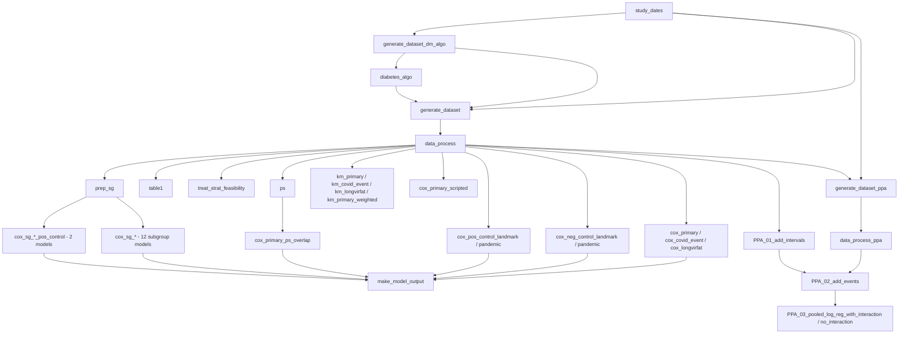

# Implications of metformin for severe and Long COVID

[View on OpenSAFELY](https://jobs.opensafely.org/repo/https%253A%252F%252Fgithub.com%252Fopensafely%252Fmetformin_covid)

Metformin is the most commonly prescribed first-line treatment for Type 2 diabetes mellitus (T2DM) and is an inexpensive, readily accessible medication with a well-known safety profile. 

Metformin was explored as a promising drug repurposing candidate for the prevention and treatment of severe COVID-19 and Long COVID-19 due to its hypothesized [anti-inflammatory and even antiviral properties](https://academic.oup.com/cid/article/79/2/292/7659664?login=false#google_vignette). 

Several randomised trials have evaluated the use of metformin during the acute phase of COVID-19 among a broad at-risk population, summarized in a [recent meta-analysis](https://bmjmedicine.bmj.com/content/4/1/e001126). The analysis concludes that metformin has little to no effect on mortality, some (but uncertain) effect on severe COVID-19 and a potential effect in reducing the risk of Long COVID.
This is in contrast to most results from observational studies and meta-analyses thereof. There are several possible explanations: First, people with T2DM were largely excluded from the randomized trials since randomising such patients to metformin or placebo is likely unfeasible and unethical. T2DM is an important risk factor for severe COVID-19 and appropriate blood glucose control with metformin (or other antidiabetic treatments) could itself impact the course of the disease. Second, most patients in observational studies were admitted to hospital - while patients from the randomized trials were recruited in the primary care setting, presenting with non-severe COVID-19. Third, most observational studies used a prevalent-user design comparing people receiving (long-term) metformin. This design is addressing a causal question of “being on metformin vs not being on metformin”, which cannot be translated to clinical decision-making nor how a randomized trial investigating the effect of metformin on COVID outcomes would be designed. It also may introduce bias under certain circumstances. Fourth, other design-related and confounding biases in the observational studies could be an explanation.

Following the target trial emulation framework, we aim to estimate the effect of starting metformin versus not starting metformin in the primary care setting, among adults living with T2DM in England, on COVID-19 related hospitalisations or death, SARS-CoV-2 infection, and Long COVID diagnoses, and explore different study design approaches.

Details of the purpose and any published outputs from this project can be found at the link above.

The contents of this repository MUST NOT be considered an accurate or valid representation of the study or its purpose. 
This repository may reflect an incomplete or incorrect analysis with no further ongoing work.
The content has ONLY been made public to support the OpenSAFELY [open science and transparency principles](https://www.opensafely.org/about/#contributing-to-best-practice-around-open-science) and to support the sharing of re-usable code for other subsequent users.
No clinical, policy or safety conclusions must be drawn from the contents of this repository.

# Repository structure

```
analysis/                    Python (ehrql) dataset definitions and R analysis scripts
  functions/                   Shared R helper functions, sourced by the scripts above
  make_output/                 Pools Cox model results across all outcomes and subgroups
  superseded/                  Archived dataset definitions/scripts, no longer run
codelists/                   Clinical codelists used by the ehrql dataset definitions
metadata/                    Auto-generated run logs, one per project.yaml action
output/                      Action outputs (dummy-data outputs are committed here)
protocol/                    Versioned study protocol documents
project.yaml                 OpenSAFELY pipeline - the data flow
```

# Data flow

The pipeline is defined by [project.yaml](project.yaml); each box below is a `project.yaml`
action and arrows show `needs:` dependencies. Repetitive subgroup/outcome actions are
grouped into a single box for readability.



Stage summary:

1. **Study setup**: `study_dates` fixes key study dates used throughout.
2. **Dataset generation** (ehrql, Python): `generate_dataset_dm_algo` extracts raw
   variables for the diabetes algorithm; the external `diabetes_algo` action classifies
   T1DM/T2DM/gestational/other diabetes; `generate_dataset` then extracts the full T2DM
   study population and variables.
3. **Data processing** (R): `data_process` applies eligibility/QA/completeness criteria
   and builds the analysis-ready datasets (`data_processed*.arrow`), plus flowchart
   tables and descriptive plots.
4. **Descriptives, propensity scores, Kaplan-Meier** - `table1`, `treat_strat_feasibility`,
   `ps` (propensity score model + trimmed/overlap dataset), and the
   `kaplan-meier-function` action runs on the primary/COVID/Long COVID/weighted outcomes.
5. **Cox models** (`cox-ipw` action) - primary, PS-overlap, COVID, Long COVID, negative
   and positive control outcomes, each stratified by region with a shared covariate set.
6. **Subgroup analyses** - `prep_sg` builds subgroup datasets (age, sex, ethnicity, IMD,
   BMI, HbA1c strata); each feeds its own `cox_sg_*` Cox model.
7. **Pooling** - `make_model_output` combines every Cox model's output into
   `results_cox.csv` / `results_cox_midpoint6.csv`.
8. **Per-protocol analysis (PPA)**: `generate_dataset_ppa` and `data_process_ppa` build a
   supplementary dataset used later by the pooled logistic regression for the per protocol analysis (PPA). 
   `PPA_01_add_intervals` expands data into monthly intervals, `PPA_02_add_events` adds treatment/outcome/censoring events, 
   and `PPA_03_pooled_log_reg_*` fits the pooled logistic regression with and without
   treatment-time interaction.

`figures_tables` is also defined as a `project.yaml` action but is
**local/dummy-data only** - never requested as a real-data job. It builds manuscript
figures/tables from already-released, disclosure-safe `output/data_release_*` snapshots
that only ever exist on a local machine (gitignored, not produced by any action here).

`analysis/dag.R` builds the study's conceptual DAG figure but is **not** a `project.yaml`
action - it depends on `ggdag`, which isn't part of the OpenSAFELY `r:v2` image, so run
it directly with `Rscript`/RStudio on your own machine.

# About the OpenSAFELY framework

The OpenSAFELY framework is a Trusted Research Environment (TRE) for electronic
health records research in the NHS, with a focus on public accountability and
research quality.

Read more at [OpenSAFELY.org](https://opensafely.org).

# Licences
As standard, research projects have a MIT license. 
